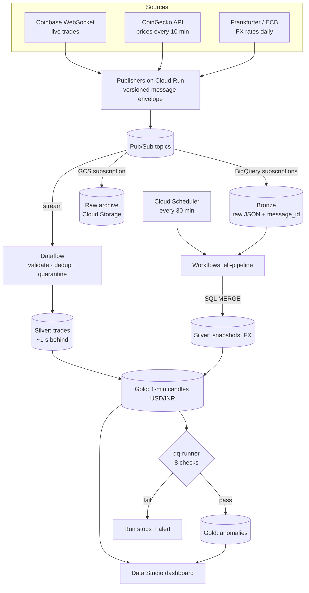

# Real-Time Crypto Market Analytics & Anomaly Detection on GCP

A production-style data platform on Google Cloud that streams live crypto trades, cleans them through **Bronze → Silver → Gold** layers, gates every batch run with **data-quality checks**, detects **market anomalies** with explainable statistics, and serves a dashboard. Every workload runs as a **dedicated least-privilege service account**, and **no service account keys exist anywhere**, including CI/CD.


---

## Results at a glance

| | |
|---|---|
| **Overnight stream (~10 h)** | 844,336 trades reconciled Bronze → Silver **by key**, 0 missing |
| **Streaming latency** | Silver ~1 second behind the market |
| **Batch pipeline** | Every 30 min, ~2 min per run, unattended |
| **Data quality** | 8 checks across 5 dimensions, gating every run |
| **Anomaly detection** | Live market drops detected within ~9 minutes, no human action |
| **CI/CD** | Keyless GitHub Actions deploy via Workload Identity Federation (39 s) |
| **Decisions documented** | 13 Architecture Decision Records |

---

## Architecture



**Cross-cutting:** Terraform for all infrastructure · Cloud Monitoring alerts · GitHub Actions CI/CD · service accounts only.

---

## Data sources

| Source | Data | Cadence | Path |
|---|---|---|---|
| Coinbase WebSocket | BTC-USD, ETH-USD trades | Real time | Pub/Sub → Dataflow → `silver.trades` |
| CoinGecko `/coins/markets` | Price, market cap, 24h volume | Every 10 min | Pub/Sub → Bronze → SQL MERGE |
| Frankfurter (ECB rates) | USD → INR and other FX | Business days | Pub/Sub → Bronze → SQL MERGE |

Market data provided by [CoinGecko](https://www.coingecko.com).

---

## How it works

### Bronze: raw and replayable
Pub/Sub **BigQuery subscriptions** land every message as raw JSON with `message_id` and `publish_time`, with no landing code to maintain. A second subscription archives messages to Cloud Storage for replay.

### Silver: clean and deduplicated
- **Streaming (Dataflow):** parses the envelope, validates fields, sends bad records to `silver.trades_quarantine` with the error and raw payload, and deduplicates per trade (Pub/Sub is at-least-once).
- **Batch (SQL MERGE):** CoinGecko snapshots are insert-only (facts at a point in time); FX rates are upserted (SCD Type 1).

### Gold: shaped for questions
- `ohlcv_1m`: 1-minute candles, rebuilt over a 3-day window with upserts, so late trades are folded in and re-runs are idempotent.
- `ohlcv_1m_inr`: an **as-of join** to FX validity ranges built with `LEAD()`, because ECB publishes no weekend rates.
- `anomalies`: see below.

### Data quality gate
Each check is a SQL file returning **one row** (name, dimension, status, observed value, message). The `dq-runner` Cloud Run job runs them all, stores results in `ops.dq_results` **before** deciding, logs structured JSON with severity, and exits non-zero on failure, which **stops the workflow** so bad data never reaches anomalies or the dashboard.

Dimensions covered: uniqueness, validity, consistency (Gold vs Silver), freshness, reconciliation.

### Anomaly detection
Three explainable z-score rules, calibrated on real data:

| Rule | Baseline | Flags when |
|---|---|---|
| `price_jump` | Trailing 24 h of 10-min returns | \|z\| > 4 (HIGH > 6) |
| `volume_surge` | Trailing 60 min of log(volume), ≥ 40 bars | z > 3 (HIGH > 4) |
| `divergence_break` | CoinGecko vs Coinbase VWAP | Gap > 0.5% + recent 5-min move |

Baselines **exclude the current point** (a spike cannot hide itself) and use **time-based windows**. Each flag explains itself, e.g. *"-1.936% in 9 min; typical move 0.246%"*.

---

## Security model

- **Service accounts only** for application work; the owner account is used for setup only.
- **Least privilege at resource level:** roles on a topic, dataset or job, not the project, wherever possible.
- **No keys:** local work uses service account **impersonation**; cloud services use **attached** identities; GitHub Actions uses **Workload Identity Federation**.

| Service account | Purpose |
|---|---|
| `sa-tf-provisioner` | Terraform plan/apply |
| `sa-ingest-run` | Publish to Pub/Sub topics |
| `sa-pubsub-bq-writer` / `sa-pubsub-gcs-writer` | Land messages in Bronze / archive |
| `sa-dataflow-worker` | Streaming pipeline |
| `sa-orchestrator` | Workflows, SQL MERGEs, DQ runner |
| `sa-scheduler` | Trigger scheduled jobs |
| `sa-cicd-deployer` | CI/CD deploys (WIF, this repo's `main` branch only) |

One documented exception: the Data Studio report reads Gold views with the owner's credentials, because a personal Google account cannot use Data Studio service account credentials ([ADR-0012](docs/adr/0012-dashboard-looker-studio-owner-credentials.md)).

---

## Monitoring

| Alert | Catches |
|---|---|
| Workflow execution **FAILED** | Loud failures |
| Cloud Run job **ERROR** logs | *Which* DQ check failed, and why |
| **No successful run for 90 min** | Silent absence: a paused scheduler or broken trigger |

---

## CI/CD

| Workflow | Trigger | Does | GCP access |
|---|---|---|---|
| `ci.yml` | Every PR and push | `terraform fmt -check`, `terraform validate`, `ruff` | None |
| `deploy-dq-runner.yml` | Push to `main` (runner paths) or manual | Build image → Artifact Registry (tagged with commit SHA) → update Cloud Run job | `sa-cicd-deployer` via WIF |

The WIF provider accepts only tokens from **this repository** on the **`main` branch**. No secrets are stored in GitHub.

---

## Key findings

- **Fat tails:** 2–3 returns per coin beyond 4σ in 243 points, where a normal distribution predicts about zero.
- **Volatility clustering:** after a jump, the baseline widens and the next move must be larger to count.
- **BTC and ETH move together:** every price event hit both coins, but with different severities, because each is scored against its own volatility.
- **Short baselines mislead at night:** a 15-min volume baseline flagged 24 "surges" overnight; 60 minutes kept the 9 real ones.
- **CoinGecko lags the market:** divergence tracks market direction, so the divergence threshold grows with recent moves.

---

## Repository layout

```
infra/
  bootstrap/            one-time setup notes (IAM grants done by the owner)
  envs/dev/             Terraform: APIs, IAM, Pub/Sub, BigQuery, Workflows,
                        Scheduler, Monitoring, WIF
sql/
  silver/               MERGEs into Silver
  gold/                 candles, anomalies, views
  dq/                   data-quality checks (one row per check)
  maintenance/          audited one-off changes
dataflow/               streaming pipeline (Apache Beam)
docker/dq-runner/       DQ runner image
tools/                  run_sql.py, run_dq.py
docs/
  adr/                  13 Architecture Decision Records
  runbooks/             streaming session runbook
  images/               dashboard export
.github/workflows/      CI and deploy
```

---

## Architecture Decision Records

All major decisions are recorded in [`docs/adr/`](docs/adr/), including:

- [ADR-0008](docs/adr/): SQL ELT with BigQuery MERGE
- [ADR-0009](docs/adr/): Workflows + Scheduler for orchestration (instead of Composer)
- [ADR-0010](docs/adr/0010-anomaly-detection-rules.md): explainable anomaly rules and their recalibration
- [ADR-0011](docs/adr/0011-monitoring-and-alerting.md): monitoring and alerting
- [ADR-0012](docs/adr/0012-dashboard-looker-studio-owner-credentials.md): dashboard credentials exception
- [ADR-0013](docs/adr/0013-cicd-keyless-github-actions-wif.md): keyless CI/CD with WIF

---

## Cost

Built to run on a small budget: serverless and scale-to-zero services, Workflows instead of an always-on Composer environment, partitioned and clustered tables, and short streaming sessions that are **drained** when done. The batch platform runs for a few hundred rupees over the life of the project; streaming costs roughly $0.10–0.25 per 30-minute session.

---

## Known gaps and next steps

- **Watermark** between streaming and batch, so both can run at once without reading a minute that is still filling.
- A **conformed asset dimension** (`dim_assets`): Coinbase uses `ETH-USD`, CoinGecko `ethereum`.
- A dedicated **operator service account** for streaming sessions, separate from the CI/CD deployer.
- **Notifications** for HIGH anomalies; **ML-based detection** once weeks of history exist.

---

## Tech stack

Google Cloud: Pub/Sub · Dataflow (Apache Beam) · BigQuery · Cloud Storage · Cloud Run (jobs and worker pools) · Workflows · Cloud Scheduler · Cloud Monitoring and Logging · Artifact Registry · IAM and Workload Identity Federation · Data Studio
Tooling: Terraform · Python · SQL · Docker · GitHub Actions
